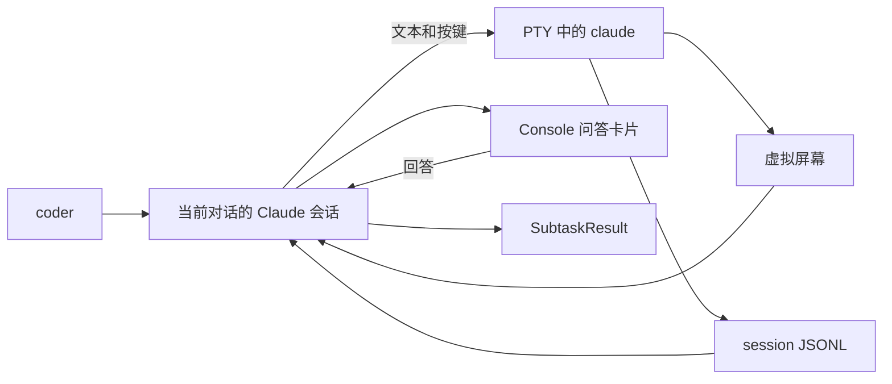

# Coder Tool 的 Claude 持续终端会话

## 目标与范围

Console local 的 `coder` 在受控 PTY 中运行交互式 Claude Code。同一对话、同一工作目录的后续调用复用进程。Claude 提问时，Console 展示现有问答卡片，回答再写入终端。

**只允许 TUI 和 session JSONL 两个信息来源，不使用 Claude Code hooks。**

首版使用 Unix PTY，已在 Linux 上验证；macOS 尚未实测。Codex 和其他 runtime 保留原实现。Console 的终端路径失败时返回错误，不自动切换到 `claude -p`。

Console 只接收以下内容：

| 内容 | 处理 |
| --- | --- |
| 本轮最终回答 | 保留 Markdown，返回 `SubtaskResult` |
| 问题与选项 | 使用现有问答卡片 |
| 开始、工作、等待回答、结束 | 简短状态 |
| 编辑日志、diff、命令输出、thinking | 不转发 |

“关键 Markdown”限定为最终回答和问题说明。交付给用户的代码块保留。不增加重要性评分、摘要模型、文件修改时间线或浏览器终端。

## 研究结论

`claude` 默认进入交互模式，`-p` 才是非交互入口。交互模式支持 `--session-id`；`--ax-screen-reader` 使用较简单的无障碍布局。输入框在执行期间也可能出现，不能据此认定任务结束。[CLI reference](https://code.claude.com/docs/en/cli-reference)、[Interactive mode](https://code.claude.com/docs/en/interactive-mode)

Transcript JSONL 是内部格式，会随版本变化。启动时指定 session UUID，在 Claude 的 projects 目录中按 `<uuid>.jsonl` 找到本会话文件，不猜测项目目录编码，也不查找“最近修改的 JSONL”。[Manage sessions](https://code.claude.com/docs/en/sessions#where-transcripts-are-stored)

完整历史恢复涉及消息分支和压缩；官方 SDK 为此使用 `uuid`、`parentUuid` 等字段。本实现只读取当前调用新增的消息，不恢复任意历史，不解析工具执行图。[SDK sessions.py](https://github.com/anthropics/claude-agent-sdk-python/blob/main/src/claude_agent_sdk/_internal/sessions.py)

真实 CLI 样本中，用户输入和 assistant 消息保存在 JSONL，assistant 消息还带有 `message.id` 与 `stop_reason`。`end_turn` 表示模型结束响应，`tool_use` 表示还要执行工具。因此本实现同时检查本轮 JSONL 和 TUI 空闲状态，不把单个模型响应或输入框出现视为整个调用结束。[Stop reasons](https://platform.claude.com/docs/en/build-with-claude/handling-stop-reasons)

## 实现结构



`internal/claudeterm` 管理进程、终端、状态识别和 JSONL 读取。`taskruntime.Runtime` 持有会话集合，把父任务的问答回调接入执行器。`agent.WithClaudeCoder` 注入执行函数，避免 agent 依赖 runtime。

使用 `creack/pty` 创建控制终端，`charmbracelet/x/vt` 处理终端转义与 Unicode。仓库的 ultraviolet replacement 缺少 `screen` 子包，已补入相同上游版本的原文件，没有另写屏幕模拟器。[PTY 源码](https://github.com/creack/pty/blob/master/start.go)、[VT 源码](https://github.com/charmbracelet/x/tree/main/vt)

没有通用 backend 接口、终端服务、独立守护进程、ACP 或 Agent SDK。

## 会话与输入

每个 runtime 内，一个 conversation 最多有一个 Claude 进程。同一 cwd 正常完成后保留进程；更换 cwd 时创建新会话。同一会话已有调用运行时，第二个调用直接报忙。

对话重置、删除或 runtime 关闭时释放进程，下次调用创建新会话。调用取消、超时、失败或用户拒绝权限时关闭进程组，但在内存中记住该会话的 UUID 和 cwd；同一对话、同一 cwd 的下次调用用 `--resume <uuid>` 重新打开，Claude 保留之前的对话上下文。空闲期间进程自行退出时同样处理。

只记住已经提交过任务的会话。重新打开的进程在任务送达前失败（调用方主动取消或超时除外），说明恢复本身不可用，下次调用改为创建新会话。更换 cwd、对话重置或删除都清除记录。记录不写入磁盘，Console 重启后从新会话开始。不重放失败的任务，也不自动重试；跨调用不保存上一任务的 ctx、问答回调或事件 sink。

实测 `2.1.316` 的 `--resume` 沿用原 session UUID，向同一个 JSONL 追加记录，不再显示目录信任提示。由于恢复后的 JSONL 已包含之前各轮，提交任务前先定位文件并从当前末尾开始读取。

启动命令：

```text
claude --session-id <uuid> --ax-screen-reader --permission-mode default
claude --resume <uuid> --ax-screen-reader --permission-mode default    # 失败后重新打开
```

使用已安装的 Claude，沿用现有 `path_extra` 和命令查找。固定 `TERM=xterm-256color`、120×40，不跟随浏览器尺寸。使用普通权限模式，不传 `--dangerously-skip-permissions`。用户原有的 Claude 权限规则仍有效。

任务通过 bracketed paste 输入，前面加 `Coding task:` 和换行，避免任务开头的 `/`、`!` 被当作终端命令。主任务允许多行和中文。实际内容通过本轮 JSONL 的用户消息核对。

无障碍问答框与主输入框的行为不同：问答框只接收逐字输入，不能直接粘贴整段文字。执行器等待字符回显或光标移动，并留出 100 ms 让输入处理器更新，再发送下一个字符或回车。这个间隔处理已实测的终端输入时序，不是重试机制。单行问答里的换行、回车和制表符转换为空格。

## 状态与结果

运行时只读取两种信息：

| 来源 | 用途 |
| --- | --- |
| TUI 虚拟屏幕 | 主输入状态、问题、选项、忙碌或空闲 |
| session JSONL | 核对本轮提交、读取原始 Markdown、识别模型完成与 API 错误 |

从子进程环境的 `CLAUDE_CONFIG_DIR` 定位 projects 目录，未设置时使用用户目录下的 `.claude`。只在首次提交后查找指定 UUID，找到后缓存路径。不遍历子 agent 目录，不读取其他会话内容。[Environment variables](https://code.claude.com/docs/en/env-vars)

每轮提交前记录 JSONL 字节位置，之后只读取新增完整行，未写完的末行留到下次。首先核对本轮用户输入，再处理后续 assistant 消息。工具输出、sidechain、元信息与压缩摘要直接跳过。

同一 `message.id` 的文本块拼接成 Markdown；新的 assistant 消息替换上一条候选回答。只有本轮 assistant 的 `stop_reason` 为 `end_turn` 或 `stop_sequence`，且 TUI 回到空闲输入状态时，才返回结果。`tool_use`、文件 EOF、短时间无输出都不表示成功。JSONL 中的 `isApiErrorMessage` 返回失败。

主循环每 100 ms 检查屏幕和本会话新增记录。没有 hook 子进程、hook 状态文件、HTTP 状态接口或其他信号来源。任务输入和回答全部写入同一个 PTY。

原始 TUI 字节记录保存在 `file_cache_dir/coder/terminal-*` 的 `terminal.log`，仅用于诊断，不作为另一个状态通道，也不进入 Console 活动流。它不属于旧一次性 coder 的诊断清理列表；需要清理时可删除已结束会话的目录。

## 问答与权限

解析器只识别屏幕底部的无障碍提示：目录信任、编号单选、Other 文本输入和工具权限选项。保留选项的原有许可范围，例如“一次允许”和“本会话允许”。文件权限保留目标与决策说明，省略 diff；命令权限保留屏幕给出的命令说明。

通过父任务的 `AskUserFunc` 提问，不调用 `askUserTool.Execute`，也不改变普通 spawn 的问答规则。等待受本次任务 ctx 控制，不另加问答超时或自动选择。

问答数据增加 `choices_only`，默认 false：

- Claude 选择菜单设为 true，Console 隐藏文本框，后端拒绝文本答案。
- 普通聊天追加消息仍进入 steer 队列，不变成权限回答。
- Other 文本问题设为 false；普通 Morph `ask_user` 行为保持不变。

提交回答前检查当前问题和选项是否一致。输入框回显不算新问题。拒绝权限会结束本次 coder 调用并关闭终端，不再等待正常完成的 assistant 消息。

## 当前限制

首次适配以 Claude Code `2.1.316` 的实际无障碍布局为准，初期参数研究使用了 `2.1.314`。CLI 升级后需要重新执行交互测试。

不支持多选、多题 tab、计划编辑器、登录和配置向导，也不恢复外部切换或替换的会话。启动前需要完成 Claude 的登录与配置。可识别但不完整的选项布局报错；其他未知画面等待调用取消或既有任务超时，不猜测按键。

固定屏幕尺寸意味着超出屏幕的长问题尚未适配。自动压缩、多任务并行工具交互、macOS 和真实模型长任务未纳入本次验证。不对这些路径声称兼容。完成只表示本轮响应结束，不保证 Claude 启动的后台工作已结束；首版不管理后台任务。

## 验证方式

普通单元测试覆盖屏幕识别、问题回显、JSONL 半行、本轮归属、分块 Markdown、编辑输出过滤、等待回答时取消、并发调用限制，以及失败后的恢复规则（恢复参数、恢复失败后改为新会话、重置与更换 cwd 清除记录、进程退出不被误报为取消）。runtime 测试覆盖纯选项问题不会被聊天文字回答。

真实 CLI 测试使用已安装的 Claude，连接本地模拟 Anthropic API，在临时目录执行；不使用真实模型密钥，不访问模型服务。运行方式：

```sh
MISTERMORPH_TEST_CLAUDE=1 go test -race ./internal/claudeterm -run TestInstalledClaude -v
```

测试覆盖同一进程连续多轮、中文多行和长任务、快捷前缀、单选、Other 文本、文件写入批准与拒绝、拒绝后的下一任务以 `--resume` 恢复并带上之前各轮、Windows 换行、只有 thinking 的回合，以及分块 Markdown 保留和 API 失败。测试同时检查启动参数不含额外 `--settings`。模拟 API 验证的是终端与协议行为，不代表真实模型编码质量。Console 前端另做构建和问答数据测试。

## 与旧设计的关系

[直接 CLI 方案](feat_20260616_coder_tool_direct_cli.md) 描述一次性执行。此实现只替换 Console local 的 Claude 路径，保留原 coder 参数与启用方式，没有新增配置项。

资料核对日期：2026-10-31。
